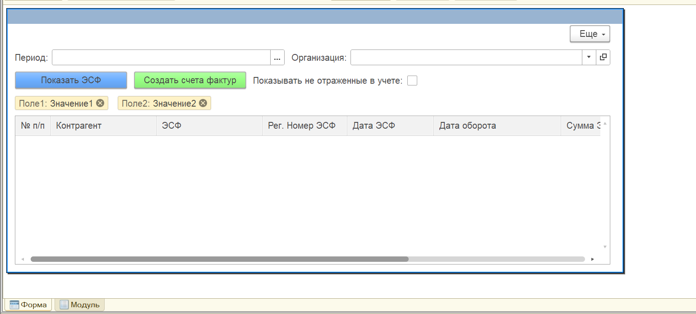
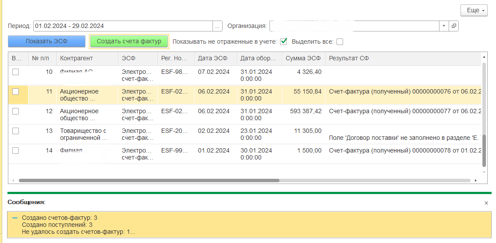

# Массовая обработка полученных ЭСФ. Создание Счета-фактуры и Поступления ТМЗ на основании ЭСФ

## О проекте

Расширение для **1С:Бухгалтерия 8 для Казахстана, редакция 3.0**.
Проект автоматизирует обработку полученных электронных счетов-фактур (ЭСФ). Пользователь выбирает необходимые ЭСФ и одной операцией создает связанные документы учета без ручного ввода.
В результате обработки автоматически создается полная цепочка документов:

ЭСФ → Счет-фактура полученный → Поступление ТМЗ
При этом между всеми документами автоматически создаются необходимые связи.

---

# Основные возможности

- просмотр полученных ЭСФ за выбранный период;
- фильтрация только не отраженных в учете ЭСФ;
- массовый выбор документов;
- массовое создание документов;
- автоматическое создание Счета-фактуры полученного;
- автоматическое создание Поступления ТМЗ;
- автоматическое связывание документов между собой;
- отображение результата обработки для каждого ЭСФ;
- подробный вывод ошибок без остановки обработки.

---

# Архитектура обработки

## 1. Получение списка ЭСФ

По выбранной организации и периоду выполняется запрос к документам ЭСФ.
Дополнительно поддерживается режим отображения только документов, которые еще не отражены в учете.

---

## 2. Проверка данных

Перед созданием документов выполняется проверка обязательных реквизитов ЭСФ.
Проверяются:
- поставщик;
- получатель;
- договор поставки;
- валюта;
- товар;
- единица измерения;
- ставка НДС.

Если хотя бы один из этих реквизитов не заполнен, документы по данному ЭСФ не создаются, а пользователю выводится сообщение с указанием раздела, поля и номера строки, в которой обнаружена ошибка.
---

## 3. Создание документов

Для каждого выбранного ЭСФ выполняется последовательность действий:

1. создается Счет-фактура полученный;
2. на основании Счета-фактуры автоматически создается Поступление ТМЗ;
3. документы записываются;
4. документы проводятся;
5. обновляются связи между документами;
6. ссылка на созданную Счет-фактуру записывается обратно в документ ЭСФ.

Такой порядок обеспечивает корректную последовательность формирования документов учета.

---

## 4. Контроль повторного создания

Перед созданием Счета-фактуры проверяется реквизит **«СчетФактура»** документа ЭСФ.
Если ссылка уже заполнена, повторное создание Счета-фактуры не выполняется.

Перед созданием Поступления выполняется поиск документа, у которого реквизит **«ДокументОснование»** содержит ссылку на созданную Счет-фактуру.
Если такое Поступление уже существует, повторное создание также не выполняется.

Это исключает создание дублирующих документов при повторном запуске обработки.

---

## 5. Автоматическое связывание документов

После создания документов автоматически формируется цепочка связей:

ЭСФ
↓
Счет-фактура полученный
↓
Поступление ТМЗ

Дополнительно выполняется проверка существующих связей.

При отсутствии связи между Счетом-фактурой и Поступлением она создается автоматически.

---

# Использованные решения

В проекте использованы:

- расширение конфигурации;
- клиент-серверная архитектура;
- запросы 1С;
- типовые механизмы заполнения документов;
- программное создание и заполнение документов;
- проведение документов программным способом;
- обработка исключений (`Попытка / Исключение`);
- массовая обработка документов;
- автоматическое обновление пользовательского интерфейса после завершения обработки.

---

# Особенности реализации

Во время разработки особое внимание уделено надежности обработки.

Решение:

- не создает дубли документов;
- продолжает обработку остальных ЭСФ при возникновении ошибки;
- формирует подробный отчет по результатам обработки;
- автоматически восстанавливает отсутствующие связи между документами;
- разделяет клиентскую и серверную бизнес-логику;
- использует стандартные механизмы заполнения документов конфигурации, что позволяет сохранить типовую бизнес-логику.

---

# Скриншоты

## Основная форма

## Результат обработки

---

# Используемые технологии

- 1С:Предприятие 8.3
- 1С:Бухгалтерия для Казахстана, редакция 3.0
- Расширения конфигурации
- Встроенный язык 1С
- Запросы 1С
